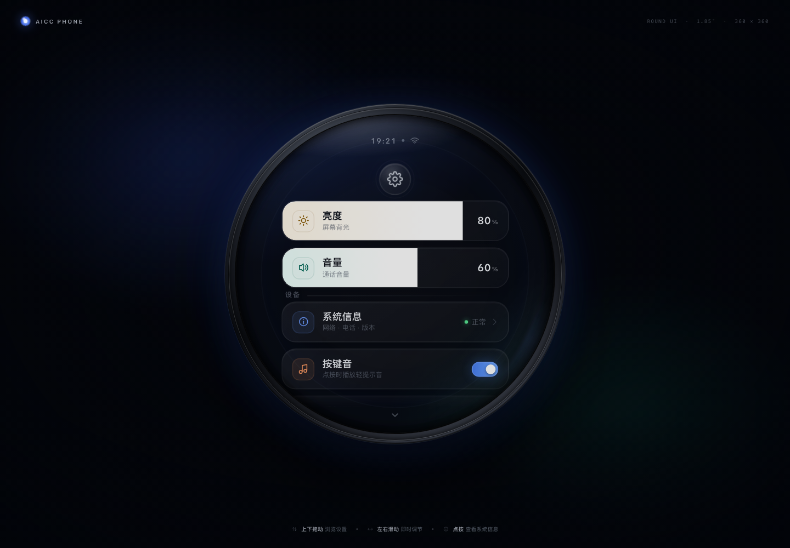
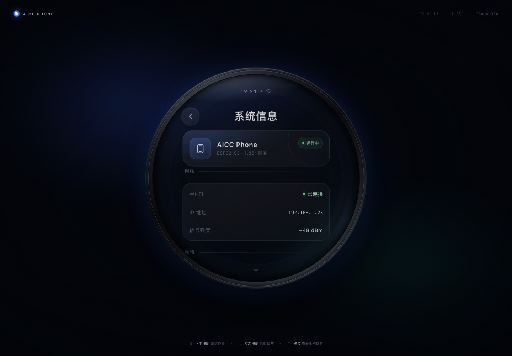
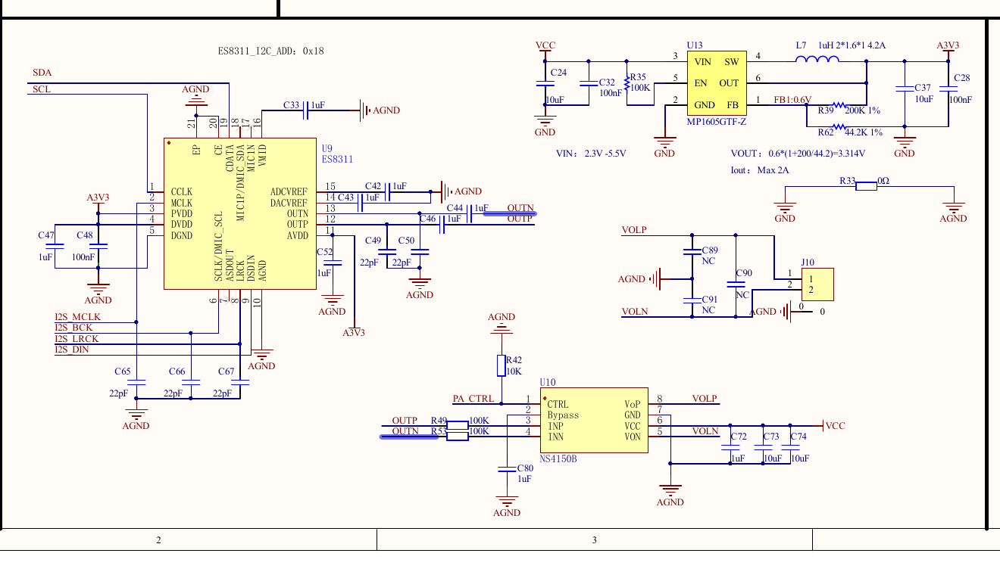
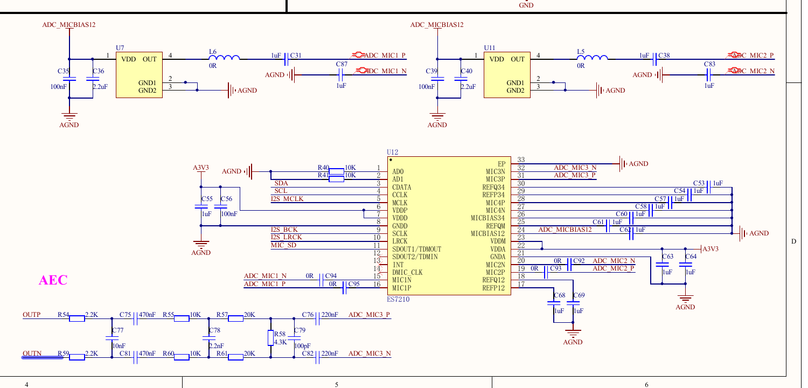

# 小安 · 酒店客房智能语音话机

> 基于 **Waveshare ESP32-S3-Touch-LCD-1.85C**（圆形 360×360 触摸屏）的一体化客房终端：
> 一句「你好小安」唤醒 AI 语音助手，也能一键 SIP 呼叫酒店前台。

<p align="center">
  
  
</p>

一块放在客房床头的圆形小话机，对客人只有两种交互：**对它说话**，或**拿起来打给前台**。
设备端用 Arduino 框架（esp32 core 3.3.x）+ LVGL 9.3 编写，自带精简 SIP/RTP 协议栈与本地唤醒词识别，
语音对话直连阿里云百炼 **Qwen-Audio Realtime** 大模型，中间无需任何中转服务器。

---

## ✨ 核心功能

### 🎙️ AI 语音助手「小安」

- **本地唤醒**：ESP-SR WakeNet9 常驻识别唤醒词 **「你好小安」**，离线、低延迟，不联网也能听。
- **直连大模型**：唤醒后通过 WebSocket 直连 `qwen-audio-3.1-realtime-flash`，实时语音进、实时语音出，
  可以像朋友一样连续聊天——常识、历史、翻译、算数、讲故事都行。
- **联网搜索**：内置 `enable_search`（默认开、网页可关），需要时小安会自动联网查天气、资讯等实时信息。
- **设备控制（Function Calling）**：动嘴就能操作这台话机，模型按需调用下列工具：

  | 工具 | 作用 | 说一句 |
  |------|------|--------|
  | `set_volume` | 调喇叭音量 | 「声音大一点」「音量调到 60」 |
  | `set_brightness` | 调屏幕亮度 | 「太亮了」「屏幕调暗点」 |
  | `get_time` | 查当前日期时间 | 「现在几点」「今天星期几」 |
  | `call_front_desk` | 拨打酒店前台 | 「帮我打给前台」「要两瓶水」 |
  | `end_conversation` | 结束对话、休眠 | 「没事了」「再见」 |

- **自动休眠**：两分钟无人说话自动关屏休眠，仅保留唤醒功能；触摸或说唤醒词即可再次唤起。

### ☎️ SIP 话机

- **一键呼叫前台**：`call_front_desk` 或拨号盘绿色按钮，直接 INVITE 到 FreeSWITCH 的前台分机（默认 `8888`）。
- **完整通话**：呼出 / 来电接听 / 挂断 / 静音 / 音量调节，圆屏显示通话计时与收发音量电平。
- **两种接入**：直连 5080 外部口（免注册）或注册 5060（digest 认证）二选一；自动通过 OPTIONS 的
  `received/rport` 学习公网地址以穿越 NAT；RTP 对称收发，G.711（PCMU/PCMA）语音。
- **通话优先**：拨打前台到挂断期间，语音助手自动让出麦克风；挂断后自动恢复会话。

### 📶 开箱配网

首次开机自动开启热点 `AICC-Phone-XXXX`（密码 `12345678`），手机连上后浏览器自动弹出配网页
（或手动打开 `http://192.168.4.1`）。页面列出附近 2.4G Wi-Fi，选一个输入密码即可。
配网成功后，同一页面在局域网内通过 `http://<设备IP>/` 打开，可配置 SIP、音量、麦克风、
语音助手 API Key、模型、联网搜索开关等全部参数。

---

## 🧩 硬件

| 部件 | 型号 | 说明 |
|------|------|------|
| 主控 | ESP32-S3（8MB PSRAM / 16MB Flash） | 双核 240MHz |
| 屏幕 | ST77916 圆形 360×360，QSPI | CST816 电容触摸 |
| 音频 DAC | ES8311 | + NS4150B 功放（PA 控制 GPIO15） |
| 音频 ADC | ES7210，4 通道 TDM | MIC1 人声 / MIC3 回采参考（接 ES8311 线路输出） |
| 扩展 IO | TCA9554 | 触摸复位、LCD 复位 |

<p align="center">
  
  
</p>

**回声消除**：使用 esp32 core 自带 esp-sr 的 AEC（`esp_aec.h`），默认参数与 xiaozhi-esp32 在本板上一致
（全双工低功耗模式 + 最强 NLP）。板上 ES7210 的第 3 路麦克风在硬件上接 ES8311 线路输出（原理图 "AEC" 区块），
作为回声参考；配置成 4 通道 TDM 后，I2S 帧里的 4 个槽位依次是 MIC1 / MIC3 / MIC2 / MIC4，槽位 1 即参考。
> ⚠️ 本板喇叭与麦克风距离极近，双讲（AI 说话时人同时说话）场景下近端人声会被 NLP 一并抑制，
> 这是该硬件的物理限制（小智官方亦未在 1.85C 上开启语音打断）。日常一问一答不受影响。

---

## 🗂️ 工程结构

```
aicc_phone/      Arduino 工程（打开 aicc_phone.ino 即可编译）
  ├─ assistant.*       语音助手状态机、Function Calling 工具
  ├─ voice_session.*   Qwen Realtime WebSocket 会话
  ├─ wake_word.*       WakeNet9「你好小安」本地唤醒
  ├─ audio.*           ES8311/ES7210 采集播放、AEC、重采样
  ├─ sip.* / rtp.*     精简 SIP/RTP 协议栈，G.711
  ├─ ui.* / face_*     LVGL 圆屏界面、表情动画
  └─ web_portal.*      配网与设置网页
tools/           编译 / 烧录 / 串口 / 字体 / 模型打包脚本
libs/WebSockets/ 内置的 arduinoWebSockets（放宽帧上限、PSRAM 分配）
design/          圆屏 UI 交互原型（HTML + 预览图）
reference/       Waveshare 官方驱动与原理图（只读参考）
docs/            设备操作手册
```

---

## 🔧 编译与烧录

**不想搭编译环境？** 仓库 `build/` 里带着编译好的最新固件，只要有 `esptool` 就能刷：

```bash
tools/flash_release.sh --models      # 新设备：固件 + 唤醒词模型一起写
```

完整步骤、手动 esptool 命令、Windows 用法和常见问题见 **[docs/flashing-new-device.md](docs/flashing-new-device.md)**。

编译环境：Arduino IDE 2（自带 arduino-cli 1.5.1）、esp32 core 3.3.10、LVGL 9.3.0
（`~/Documents/Arduino/libraries/lvgl` 及并列的 `lv_conf.h`）。

```bash
tools/build.sh                      # 编译
tools/flash.sh /dev/cu.usbmodem2101          # 烧录固件
tools/flash.sh /dev/cu.usbmodem2101 --models # 首次：连同唤醒词模型包一起烧
```

- **FQBN**：`esp32:esp32:waveshare_esp32_s3_touch_lcd_185`，PSRAM 开启，分区 `app3M_fat9M_16MB`。
- **唤醒词模型**：`tools/srmodels/srmodels_cn.bin`（WakeNet9「你好小安」）烧入 `model` 分区（4MB @0x410000），
  用 `tools/pack_models.sh` 重新打包。
- **串口日志**：`python3 tools/serial_log.py /dev/cu.usbmodem2101 <秒数> <文件>`。

---

## 🚀 快速上手

1. 烧录固件（首次加 `--models`）。
2. 手机连热点 `AICC-Phone-XXXX`（密码 `12345678`），在弹出的配网页选 Wi-Fi、填密码。
3. 配网成功后浏览器打开 `http://<设备IP>/`，在「语音助手」卡片填入百炼 API Key（可选调模型、音色、联网搜索）。
4. 对着设备说 **「你好小安」**，开始对话。
5. 需要找前台时说 **「帮我打给前台」**，或在拨号盘直接呼叫。

---

## 📄 许可与致谢

- 语音模型：阿里云百炼 [Qwen-Audio Realtime](https://help.aliyun.com/zh/model-studio/qwen-audio-realtime-user-guides)
- 唤醒词 / AEC：[ESP-SR](https://github.com/espressif/esp-sr)（WakeNet9 wn9_nihaoxiaoan_tts2）
- 音频驱动参考：[xiaozhi-esp32](https://github.com/78/xiaozhi-esp32)
- 呼叫中心后端：[aicc（ai-native-callcenter）](https://github.com/rasonyang/ai-native-callcenter)
