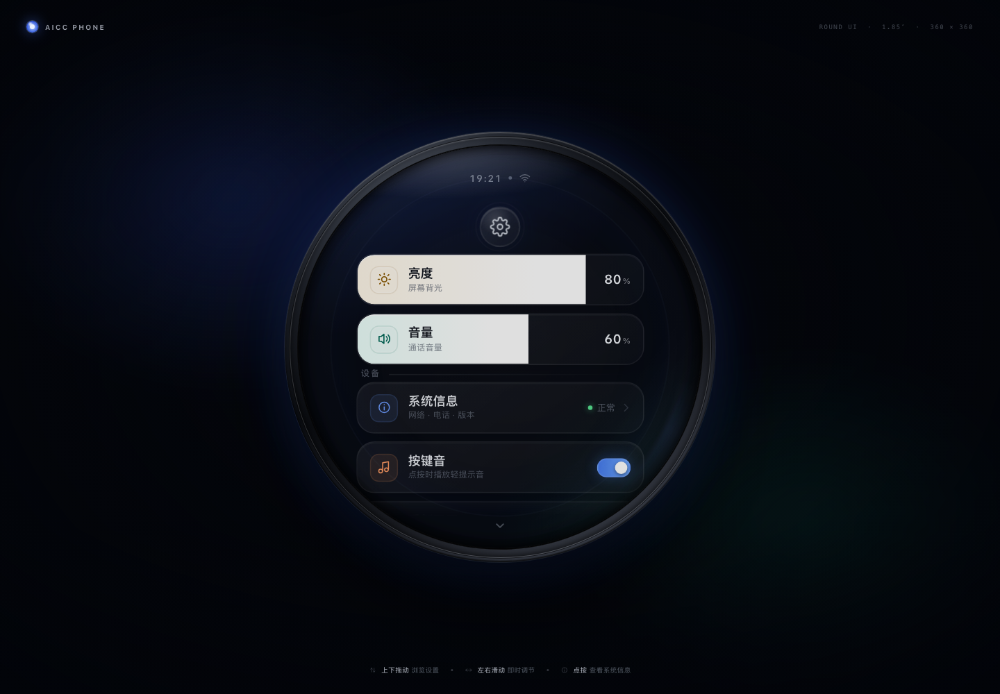
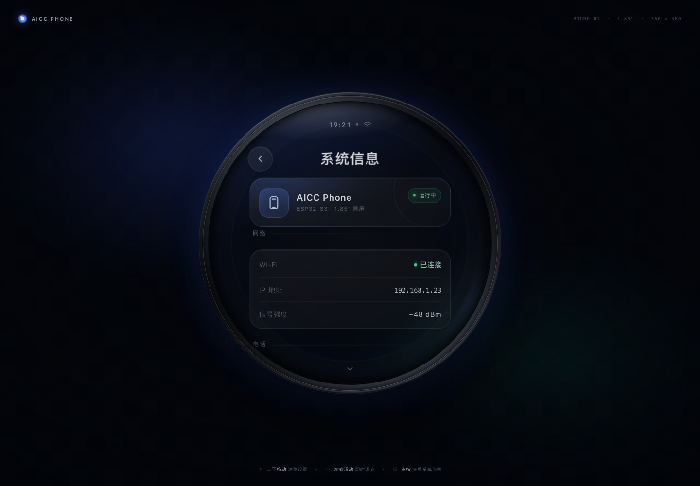

# 圆屏设置页 · HTML 交互原型

`round-settings.html` 是面向 **360 × 360 圆形触摸屏** 的独立概念原型，不依赖任何外部资源，直接用浏览器打开即可。

## 已实现

- **设置主页**：顶部居中一枚齿轮标志，不再有返回按钮和“在线”状态。
- **整行滑块**：亮度、音量占用整张菜单行，高度与其他菜单项一致（46px）；白色填充从左侧铺到当前数值，整行任意位置都可以横向拖动，点按任意位置可直接跳转数值。
- **上下滚动**：设置列表可以滚动，露出按键音、重新配网等次级设置；滑动从滑块上开始时仍可正常竖向滚动，不会误改数值。
- **系统信息页**：展示 Wi-Fi、IP、SIP、服务器、固件、运行时间等；页面本身也支持上下滚动，左上角保留返回设置按钮。
- **细节交互**：亮度/音量支持键盘方向键（`Shift` 加速）、`Home` / `End`；按键音开关、重新配网的二次确认、页面切换动画、轻量 WebAudio 提示音。
- **自适应**：内部画布固定 360 × 360，外部设备壳根据窗口尺寸缩放，手机和桌面都能预览。
- **预览参数**：`?page=info`、`?brightness=40`、`?volume=80`、`?scroll=120` 可用于截图或演示指定状态。

## 预览

## 说明

这是视觉与交互原型；亮度/音量目前在前端状态中模拟。落地到固件时，可把滑杆的 `input` 事件分别映射到 LVGL 的 `backlight_set()` 和音量回调，系统信息的数据源沿用 `ui_show_settings()` 已有的 IP / SIP / 版本字段。
