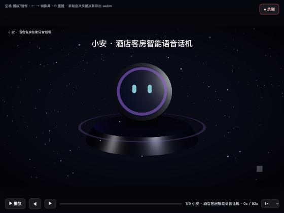
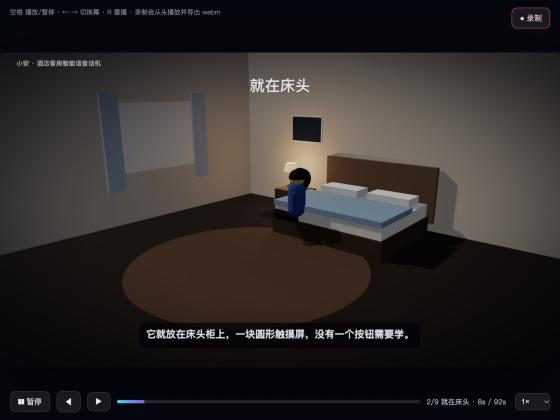
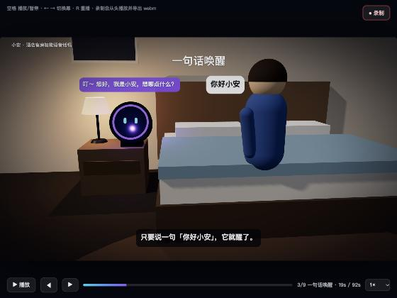
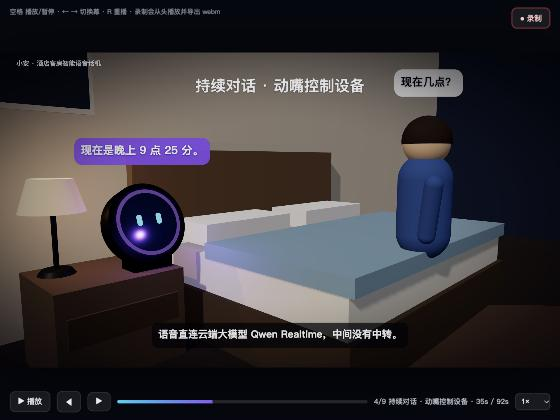
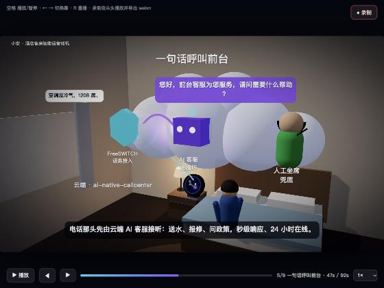
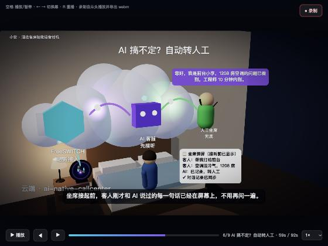
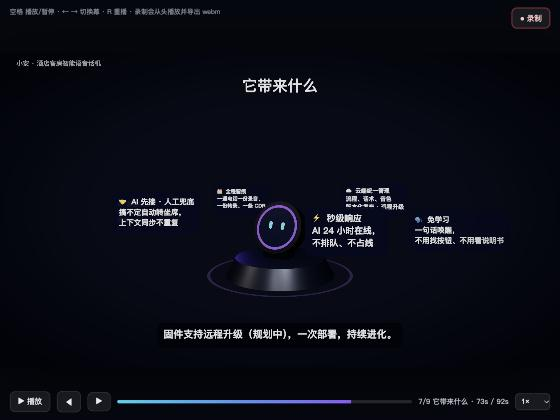
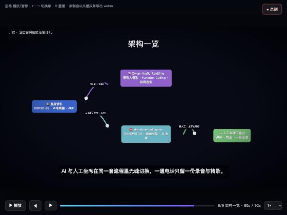
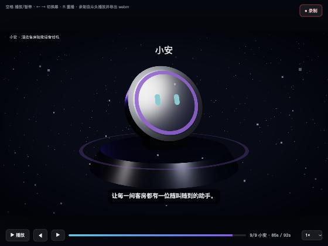

# 小安 · 酒店场景宣传短片（Three.js 3D）

`index.html` 是一支用 Three.js 实时渲染的 3D 讲解短片（约 90 秒），内容：
小安话机放在客房里怎么用 → 「你好小安」唤醒 → 语音对话与设备控制 → 一句话呼叫前台 →
云端 AI 客服先接、搞不定自动转人工坐席（对话记录同步）→ 好处总结 → 架构 → 片尾。

所有文字都画在画布里，因此录制出来的视频自带字幕。

## 播放

需要一个本地静态服务器（ES Module 不能直接 `file://` 打开）：

```bash
cd docs/promo
python3 -m http.server 8088
# 浏览器打开 http://localhost:8088/
```

- 空格：播放 / 暂停　　← →：上一幕 / 下一幕　　R：从头开始
- 右下角可调播放速度；左下角显示当前幕与进度条。
- 建议用 Chrome / Edge，窗口拉到 16:9（录制时自动按 1920×1080 画布输出）。
- 调试参数：`?t=47` 直接跳到第 47 秒并暂停；`?q=low` 关阴影、降到 1280×720（集显/老电脑用）。

## 录制成视频文件

点右上角 **● 录制**：页面会从头播放一遍并用浏览器的 MediaRecorder 把画布录成 `xiaoan-hotel-intro.webm`，
播完自动停止并下载（也可再次点击提前结束）。录制期间控件自动隐藏，不要切换标签页。

转成 MP4（可选）：

```bash
ffmpeg -i xiaoan-hotel-intro.webm -c:v libx264 -pix_fmt yuv420p -crf 18 -r 30 xiaoan-hotel-intro.mp4
```

想要更高分辨率，在 URL 后加 `?w=2560&h=1440`（录制画布尺寸）。

## 配音

短片本身没有配音，字幕即旁白稿；`script.md` 是逐幕旁白文字，可直接拿去配音或做 TTS 后用 ffmpeg 合成：

```bash
ffmpeg -i xiaoan-hotel-intro.mp4 -i voice.m4a -c:v copy -c:a aac -shortest xiaoan-hotel-intro-voiced.mp4
```

## 预览

<p> </p>
<p> </p>
<p></p>
<p> </p>
<p> </p>

## 文件

```
index.html             短片本体（Three.js r170，ES Module）
three.module.min.js    Three.js 本地副本（离线可用）
script.md              逐幕旁白 / 字幕稿
preview/               各幕截图（README 用）
```

修改文案：`index.html` 顶部的 `SCENES` 数组，每一幕有 `title`、`captions`（带时间点）、镜头关键帧。
